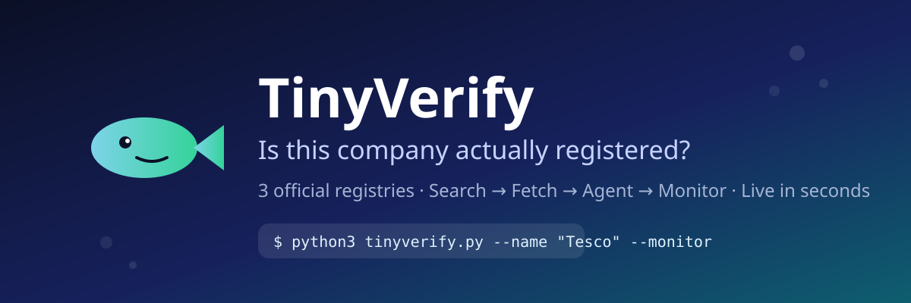
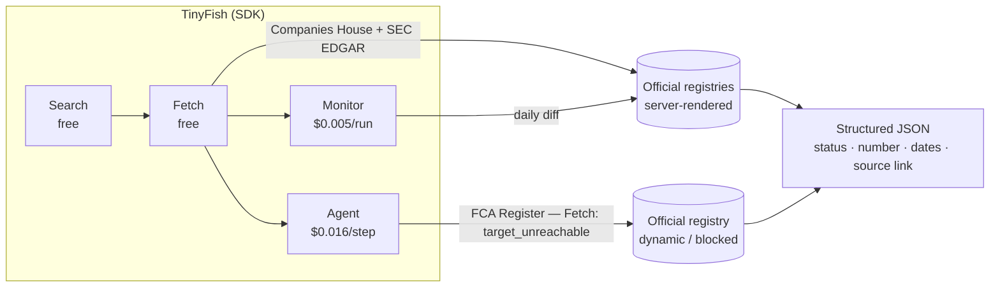

<div align="center">



# 🐟 TinyVerify

> Is this company actually registered, or just vibes? Live verification across 3 official registries with no API — in one command.

[](https://python.org/)
[](https://tinyfish.ai/)
[](https://github.com/Ehsas317/tinyverify/actions/workflows/ci.yml)
[](LICENSE)

TinyFish Student Bounty **TinyVerify** (Drop 002) · 3 endpoints → **150 pts tier**

</div>

## 📑 Contents

- [✨ Why build this?](#-why-build-this)
- [🚀 Installing / Getting started](#-installing--getting-started)
- [🎯 Usage](#-usage)
- [✨ Features](#-features)
- [⚙️ Configuration](#%EF%B8%8F-configuration)
- [🏗️ How it works](#%EF%B8%8F-how-it-works)
- [📡 Registries](#-registries)
- [💼 Where it's useful](#-where-its-useful)
- [✅ Live proof](#-live-proof)
- [📁 Project structure](#-project-structure)
- [🤝 Contributing](#-contributing)
- [🔗 Links](#-links)
- [📜 Licensing](#-licensing)

## ✨ Why build this?

> "Is this doctor licensed? Is this company still registered?" — answering that used to mean hand-searching licensing boards and registries with no APIs. **Life gets awesome when:** one command checks the official sources live and hands you a structured record you can trust — with a source link, not a screenshot of a search result.

## 🚀 Installing / Getting started

Minimal setup to your first verified record (≈1 minute):

```shell
git clone https://github.com/Ehsas317/tinyverify.git
cd tinyverify
pip install -r requirements.txt
export TINYFISH_API_KEY=...   # https://agent.tinyfish.ai/api-keys
python3 tinyverify.py --name "Tesco" --jurisdiction UK
```

What actually happens ↑: Search finds the official Companies House entry → Fetch reads the live page → JSON prints the structured record (see [Usage](#-usage)).

### Initial Configuration

| Need                              | Where to get it                    | Notes                                                                                   |
| --------------------------------- | ---------------------------------- | --------------------------------------------------------------------------------------- |
| `TINYFISH_API_KEY`                | https://agent.tinyfish.ai/api-keys | One key for Search/Fetch/Agent/Monitor. Search + Fetch are free within daily allowance. |
| `pip install -r requirements.txt` | This repo                          | Installs the `tinyfish` SDK. Nothing else is required.                                  |

Verify your setup first (free, prints monitors on your account):

```shell
python3 tinyverify.py --doctor
```

## 🎯 Usage

**One-off check (hiring / partnerships — table is fastest to read):**

```shell
python3 tinyverify.py --name "Tesco" --format table
```

```text
REGISTRY                                | NAME  | STATUS  | NUMBER  | READER
----------------------------------------+-------+---------+---------+--------
UK Companies House                      | Tesco | active  | 00445790| Fetch
UK FCA Financial Services Register      | Tesco | authorised | 201282 | Agent
US SEC EDGAR                            | Tesco | no_match | -       | Fetch

Tesco (BOTH) · endpoints: UK Companies House, UK FCA Financial Services Register, US SEC EDGAR · est. 150 pts
  verdict: partial
```

**Machine use (pipelines, agents, spreadsheets):**

```shell
python3 tinyverify.py --name "Apple" --jurisdiction US --output result.json
python3 tinyverify.py --name "Tesco" --format csv --output vendors.csv
```

**Batch vendor KYB (real use — a whole vendor list):**

```shell
# vendors.csv — one vendor per row
python3 tinyverify.py --input vendors.csv --format csv --output kyb-report.csv
```

**Watchlist (ongoing monitoring + Slack/email alerts):**

```shell
python3 tinyverify.py --name "Tesco" --jurisdiction BOTH --monitor \
  --webhook "https://hooks.slack.com/services/..." --schedule "0 9 * * *"
```

> `--monitor` creates a daily TinyFish Page Monitor per source page. When the registry record changes, the webhook receives the diff. The FCA page is skipped with a documented note (same unreachable host Agent reads through).

## ✨ Features

- ✅ **3 official registries** — UK Companies House, US SEC EDGAR, UK FCA Register (no APIs, no logins)
- ✅ **Smart TinyFish pipeline** — Search → Fetch → Agent → Monitor; Agent only where Fetch can't read
- ✅ **`verdict`** — `verified | partial | not_found | ambiguous` for compliance/hiring hand-off
- ✅ **Batch + CSV** — vendor lists in, spreadsheet-ready report out
- ✅ **Formats** — `json` (pipelines/agents) · `table` (humans) · `csv` (Excel/Sheets)
- ✅ **Monitor + webhook** — daily watchlist with Slack/email alerts
- ✅ **Retries with backoff** — one flaky page won't sink a batch
- ✅ **AI-ready (MCP)** — Claude/Cursor can call `tinyverify_check` as a tool
- ✅ **20 offline tests** — parsers + formatters + verdict, no API key needed (`make test`)

## ⚙️ Configuration

| Argument         | Type / default                  | What it does                                                                |
| ---------------- | ------------------------------- | --------------------------------------------------------------------------- |
| `--name`         | `String`                        | One name, or comma list (`"Tesco,Apple"`). Required unless `--input` given. |
| `--input`        | `String`                        | CSV file with one name per row (batch).                                     |
| `--type`         | `String` · `company`            | Record type: `company` · `person` · `licence`.                              |
| `--jurisdiction` | `UK \| US \| BOTH` · `BOTH`     | Which registries to check.                                                  |
| `--monitor`      | `bool`                          | Create a daily Monitor per source page.                                     |
| `--webhook`      | `String`                        | Monitor webhook URL (Slack/email bridge).                                   |
| `--schedule`     | `String` · `0 9 * * *`          | Monitor cron (UTC).                                                         |
| `--format`       | `json \| table \| csv` · `json` | Output format.                                                              |
| `--output`       | `String`                        | Also write the report to this file.                                         |
| `--retries`      | `Number` · `3`                  | Retries per TinyFish call (exponential backoff).                            |
| `--verbose`      | `bool`                          | Log each retry to stderr.                                                   |
| `--doctor`       | `bool`                          | Check API key + list monitors, then exit.                                   |

**Exit codes:** `0` ok · `2` usage / missing key · `3` registry fetch failed.

## 🏗️ How it works



Each primitive is used for what it's best at — Fetch for static pages ($0), Agent only for the dynamic/blocked registry, Monitor for ongoing change detection. Nothing is padded to inflate the endpoint count.

## 📡 Registries

| Registry               | Reader               | Returns                                                                       |
| ---------------------- | -------------------- | ----------------------------------------------------------------------------- |
| **UK Companies House** | Fetch                | status active/dissolved, 8-digit number, incorporated date, registered office |
| **US SEC EDGAR**       | Fetch + Agent rescue | CIK, legal name, latest 10-K date, multi-match list                           |
| **UK FCA Register**    | **Agent**            | authorised / not-authorised, FCA reference number                             |

Every check is stamped `source_url` + `checked_at` + `reader`, and `no_match` / multi-match are reported explicitly — never guessed.

## 💼 Where it's useful

- **Vendor KYB / procurement** — batch-check a vendor CSV before onboarding
- **Hiring / partnerships** — 10-second table verdict before you sign
- **Watchlists** — `--monitor` flags the day a vendor goes dissolved
- **Research / journalism** — verify a company exists before you write about it

## ✅ Live proof (2026-11-08)

| Check                   | Result                                           | Reader  |
| ----------------------- | ------------------------------------------------ | ------- |
| Tesco / Companies House | `active, 00445790, incorporated 27 Nov 1947`     | Fetch   |
| Tesco / FCA Register    | `authorised, ref 201282, 15 matches`             | Agent   |
| Apple / SEC EDGAR       | `CIK 0000320193, latest 10-K 2026-11-03`         | Fetch   |
| Monitors                | `3e4299ff…` (Companies House), `a884b06b…` (SEC) | Monitor |

Full outputs: [`examples/`](examples/) · Transcript: [`examples/DEMO.md`](examples/DEMO.md)

## 📁 Project structure

```
tinyverify/
├── __init__.py   # version
├── cli.py        # argparse + verdict + doctor
├── client.py     # TinyFish wrapper (retry/backoff)
├── checks.py     # one check per registry
├── parsers.py    # pure offline-tested parsers
├── registries.py # config
├── report.py     # JSON/CSV/table formatters + Monitors
tinyverify.py     # shim (back-compat: python3 tinyverify.py …)
tests/            # parsers + report + mocked checks
examples/         # live JSON outputs + demo transcript
docs/assets/      # banner
```

## 🤖 Use with AI (MCP)

TinyVerify ships an MCP server, so Claude, Cursor, and other agents can verify
companies as a tool call — no copy-pasting JSON:

```json
{
  "mcpServers": {
    "tinyverify": {
      "command": "tinyverify-mcp",
      "env": { "TINYFISH_API_KEY": "..." }
    }
  }
}
```

Tools: `tinyverify_check(name, jurisdiction, type)` → JSON report with `verdict`;
`tinyverify_doctor()` → key/monitor health. Install both CLIs with:

```shell
pip install -e .         # gives `tinyverify` + `tinyverify-mcp` on PATH
```

## 🤝 Contributing

Issues and PRs are welcome — see [`CONTRIBUTING.md`](CONTRIBUTING.md). Parser changes need a test; new registries need a config entry + `check_*` + test.

## 🔗 Links

- Repository: https://github.com/Ehsas317/tinyverify
- TinyFish docs: https://docs.tinyfish.ai · Playground: https://agent.tinyfish.ai/playground
- API keys: https://agent.tinyfish.ai/api-keys
- Cookbook: https://github.com/tinyfish-io/tinyfish-cookbook
- Report that bounty: https://www.tinybounties.com/crm?view=board

## 📜 Licensing

MIT — see [`LICENSE`](LICENSE).

---

<p align="right"><a href="#contents">Back to top ↑</a></p>
